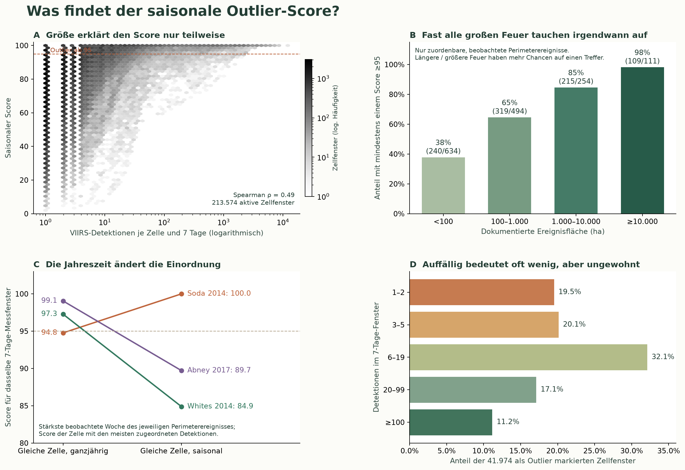

# Was findet der saisonale Outlier-Score?

Auswertung vom 15. November 2026. Untersucht wird der bestehende Standard:
**VIIRS, 7-Tage-Messfenster, saisonale Referenz ±30 Tage, Outlier ab Score 95**.
Die Detektionslogik und die Anwendung wurden für diese Analyse nicht geändert.

Der Score hat einen erkennbaren saisonalen Mehrwert und ist keine bloße Rangliste
nach Fläche. Fast alle großen beobachteten Brände haben allerdings irgendwann
einen hohen Kontextscore. Der derzeitige Score beschreibt eine **0,5°-Zelle und
ein Zeitfenster**, kein eigenständig erkanntes und abgegrenztes Feuer. Gerade bei
kleinen Feuern kann das Umfeld den Score bestimmen. Ein hoher Score belegt
historische Seltenheit der gemessenen Aktivität in diesem Vergleich, nicht ihre
Gefährlichkeit oder eine validierte Alarmqualität.



## Vollständiger Scan der aktuellen Referenz

Alle verfügbaren täglichen Anker wurden ausgewertet, nicht nur ausgewählte
bekannte Katastrophen. Der erste verfügbare Anker ist 23. Januar 2012, der letzte
28. Dezember 2025. Bekannte Ausfälle und unvollständige Messfenster bleiben
unverfügbar. Alle Kalenderjahre, die ein Zielfenster berührt, werden aus seiner
Referenz ausgeschlossen. Die Vergleichsfenster sind stark überlappend und die
Zellen räumlich abhängig; die folgenden Zahlen sind keine unabhängigen Versuche.

| Größe | Ergebnis |
| --- | ---: |
| Auswertbare Zell-Zeitfenster | 1.122.688 |
| Davon mit mindestens einer Detektion | 213.574 |
| Score ≥95 | 41.974 = 3,74 % aller bzw. 19,65 % aktiver Fenster |
| Score ≥99 | 14.922 = 1,33 % aller bzw. 6,99 % aktiver Fenster |
| Spearman-Korrelation Score / Detektionszahl, nur aktive Fenster | 0,495 |
| Markierte Fenster mit höchstens zwei Detektionen | 19,5 % |
| Markierte Fenster mit höchstens fünf Detektionen | 39,6 % |
| Markierte Fenster mit mindestens 100 Detektionen | 11,2 % |
| Fenster mit mindestens 100 Detektionen, die **nicht** Score 95 erreichen | 24,3 % |

Hohe Aktivität erhöht die Chance eines hohen Scores, bestimmt ihn aber nicht
allein. Von Fenstern mit genau einer Detektion werden 6,2 % markiert, von Fenstern
mit 100–499 Detektionen 67,6 %, von Fenstern mit mindestens 500 Detektionen 86,9 %.
Diese Angaben beziehen sich auf Detektionen und Fenster, nicht auf Feuergrößen
oder die Zahl eigenständiger Feuer.

## Verbindung zu dokumentierten Feuern

Die rückblickende Zuordnung verwendet die originalen CAL-FIRE-Perimeter und
Alarm-/Containment-Daten. Ein VIIRS-Punkt wird nur zugeordnet, wenn sein Zentrum
innerhalb des gespeicherten Perimeters und sein UTC-Datum innerhalb dieses
Ereigniszeitraums liegt. Quellen sind die vorbereiteten [NASA-/CAL-FIRE-Daten](DATA_SOURCES.md).
Perimeter und Satellitenmessungen sind unterschiedliche Beobachtungssysteme;
diese räumlich-zeitliche Überlappung ist eine Assoziation, keine unabhängig
bestätigte Identität jedes einzelnen Pixels.

Von 5.456 Perimeterdatensätzen ab 2012 haben 1.511 eine solche Assoziation.
3.886 haben keine zuordenbaren behaltenen VIIRS-Detektionen, 50 fehlen die
benötigten Datumsfelder, neun haben ungültige, außerhalb des Zeitraums liegende
oder über 365 Tage lange Datumsintervalle. Bei 1.493 assoziierten Datensätzen
existiert mindestens ein auswertbarer Zell-Tag; für erste und stärkste Woche
sind es jeweils 1.484. Kleine, nicht beobachtete Feuer fehlen besonders häufig.
Die Teilstichprobe ist deshalb keine repräsentative Stichprobe aller Brände.

| Fläche im FRAP-Datensatz | Auswertbare zugeordnete Ereignisse | Mindestens einmal Score ≥95 während einer zugeordneten Beobachtung |
| --- | ---: | ---: |
| Unter 100 ha | 634 | 240 / 634 = 37,9 % |
| 100 bis unter 1.000 ha | 494 | 319 / 494 = 64,6 % |
| 1.000 bis unter 10.000 ha | 254 | 215 / 254 = 84,6 % |
| Ab 10.000 ha | 111 | 109 / 111 = 98,2 % |

**Ja: Fast alle sehr großen beobachteten Feuer tauchen irgendwann auf.** Größere
und länger dauernde Brände haben zugleich mehr Zellen und Zeitpunkte und damit
mehr Gelegenheiten, einen hohen Score zu erreichen. Das sind keine Recall-Werte
gegen eine unabhängige Liste fachlich definierter Outlier.

Für einen weniger durch viele Zeitpunkte begünstigten Vergleich wurde zusätzlich
pro Ereignis die erste Woche und die stärkste beobachtete Sieben-Tage-Phase
untersucht. Die stärkste Phase wird anhand der Detektionszahl **innerhalb des
Perimeters** gewählt, nicht anhand ihres Scores. Berichtet wird der Kontextscore
der Zelle mit den meisten zugeordneten Ereignisdetektionen in dieser Phase.

- In der ersten Woche sind 98 von 110 Ereignissen ab 10.000 ha auffällig (89,1 %),
  gegenüber 223 von 630 unter 100 ha (35,4 %).
- In der stärksten Phase sind es 107 von 110 (97,3 %) bzw. 222 von 630 (35,2 %).
- Die Rangkorrelation zwischen Ereignisfläche und Score der stärksten Phase
  beträgt 0,504. Nach Ausschluss von Datensätzen mit Complex-ID/-Name oder
  „COMPLEX“ im Namen beträgt sie 0,508 (1.302 Datensätze). Unbekannte Verknüpfungen
  und andere Abhängigkeiten bleiben möglich.

## Welchen Zusatznutzen hat die saisonale Referenz?

Als Kontrollvergleich wurde dieselbe gemessene Aktivität in derselben Zelle mit
einer **ganzjährigen**, ebenfalls nach Referenzjahren gleich gewichteten
Verteilung verglichen. Beide Referenzen schließen das Zieljahr sowie darüber
laufende Referenz-Messfenster aus. Für diesen Kontrollvergleich wurden
Zielfenster über Jahresgrenzen ausgespart; die Hauptauswertung schließt sie ein.
Es verbleiben 211.381 aktive Vergleichsfenster.

Bei Schwelle 95 sind 12.447 Fenster nur mit saisonalem Vergleich auffällig,
29.109 mit beiden Referenzen und 11.140 nur mit der ganzjährigen Referenz.
Damit kommen **30,0 % der saisonalen Treffer** erst durch die saisonale
Konditionierung zustande. Bei Schwelle 99 sind es 52,9 %. Dies zeigt, dass die
Jahreszeit die Auswahl materiell verändert. Es ist kein Beleg, dass jede dieser
Änderungen fachlich erwünscht oder meteorologisch verursacht ist.

Konkrete Beispiele, jeweils stärkste beobachtete Sieben-Tage-Phase:

| Ereignis | Ankerdatum | FRAP-Fläche | Detektionen der Kontextzelle | Score ganzjährig | Score saisonal |
| --- | --- | ---: | ---: | ---: | ---: |
| Soda 2014 | 18.01.2014 | 576 ha | 103 | 94,8 | **100,0** |
| Whites 2014 | 14.08.2014 | 13.676 ha | 728 | 97,3 | **84,9** |
| Abney 2017 | 01.09.2017 | 13.311 ha | 1.797 | 99,1 | **89,7** |
| Palisades 2025 | 10.01.2025 | 9.489 ha | 1.016 | 99,9 | **100,0** |
| Old Woman 2021 | 21.06.2021 | 19 ha | 2 | 100,0 | **100,0** |

Soda wird als im Januar ungewöhnlich erkannt, während sehr viel höhere
Sommeraktivität bei Whites und Abney in ihren saisonalen Verteilungen niedriger
liegt. **Whites und Abney werden an anderen Tagen oder in anderen Zellen dennoch
auffällig**: ihre Maxima über zugeordnete beobachtete Zell-Tage sind 97,98 und
100. Die niedrigeren Tabellenwerte bedeuten nicht, dass diese Brände während
ihres gesamten Verlaufs unmarkiert bleiben.

Als Plausibilitätsprüfung erhalten auch Camp 2018, Thomas 2017, Dixie 2021,
August Complex 2020 und Eaton 2025 in der stärksten Phase Score 100. Diese
bekannten Extremfälle belegen für sich genommen keinen zusätzlichen Nutzen
gegenüber einem reinen Aktivitätsschwellenwert. Alle Flächen in der Tabelle
stammen aus dem eingefrorenen FRAP-Geometriedatensatz; aktuelle Incident-Reports
können abweichende Flächen oder Startdaten führen. Zum Beispiel dokumentiert
[CAL FIRE Palisades im Januar 2025](https://www.fire.ca.gov/incidents/2025/1/7/palisades-fire).

## Drei wesentliche Grenzen des derzeitigen Outcomes

### 1. Seltenes Auftreten und ungewöhnliche Stärke werden vermischt

Bei 14,7 % der markierten Fenster sind mindestens 95 % des Referenzgewichts
Nullaktivität. Bei Score ≥99 sind es 22,1 %. Das ist eine andere Fragestellung
als „Ist dieser Brand bei vorhandener Feueraktivität ungewöhnlich stark?“

Old Woman 2021 ist ein konkretes Beispiel: zwei Detektionen in der Kontextzelle,
davon eine innerhalb des zugeordneten Perimeters, führen zu Score 100. Die
saisonale Referenz enthält dort ausschließlich Nullfenster. Das kann eine
korrekte Aussage über seltenes Auftreten sein. Daraus folgt weder besondere
physische Intensität noch eine zuverlässig geschätzte extreme Wahrscheinlichkeit.

Score 100 ist die Spitze einer endlichen historischen Rangliste, keine
100-prozentige Sicherheit. In der stärksten-Phasen-Stichprobe erhalten 19,1 %
der Ereignisse mindestens 99,99. Die Skala trennt die sehr extremen Fälle kaum
noch voneinander. Viele korrelierte Fenster ersetzen nicht viele unabhängig
beobachtete aktive Referenzjahre.

### 2. Die Zelle kann andere Feuer oder andere Vegetationsbrände enthalten

Bei den 222 kleinen (<100 ha), in der stärksten Phase als auffällig zugeordneten
Ereignissen beträgt der Median des Anteils innerhalb ihres eigenen Perimeters
nur 33,3 % der Detektionen in der bewerteten Zelle. Bei **71,2 %** liegt dieser
Anteil unter der Hälfte. Ein kleiner Brand kann deshalb den hohen Score einer
regional auffälligen Aktivitätsphase übernehmen. Auch Agrarbrände sind in den
behaltenen presumed-vegetation-Detektionen grundsätzlich möglich. Eine
Unterscheidung wurde hier nicht unabhängig überprüft.

Der Score bleibt als räumlicher Kontext interpretierbar. Die Beschriftung als
Score des einzelnen Feuers wäre stärker, als diese Auswertung rechtfertigt.

### 3. Eine unabhängige Bewertung fachlicher Treffer fehlt

41.974 markierte Fenster wurden über Nachbarschaft in Raum und Zeit zu 3.201
zusammenhängenden Aktivitätsepisoden verdichtet. Diese technisch definierten
Episoden sind ebenfalls keine garantierten Feueridentitäten; benachbarte Brände
können zusammenfallen. 528 Episoden haben mindestens eine räumlich-zeitliche
Perimeterassoziation mit einer tatsächlich innerhalb liegenden VIIRS-Detektion.
Die restlichen Episoden sind **nicht automatisch Fehlalarme**: unvollständige
FRAP-Erfassung, kleine Feuer, Agrarbrände und die Auflösungs-/Datumsunterschiede
verhindern diese Schlussfolgerung.

Es gibt hier keine unabhängig kuratierte Positiv-/Negativliste „ungewöhnlicher
Feuer“. Precision, Recall und fachlicher Nutzen als Alarm- oder Review-System
lassen sich daher nicht seriös beziffern. Die Auswertung überprüft das Verhalten
des Scores, seine Assoziationen und seine Grenzen; sie beweist keine
sensorunabhängige oder operative Detektionsqualität. Die zusätzliche historische
MODIS-Referenz wurde in dieser Outcome-Analyse nicht als gleichwertige Wahrheit
verwendet; ihre bekannten Kurzfensterprobleme sind separat dokumentiert.

## Empfohlene Weiterentwicklung

1. **Auftretens-Seltenheit und Stärke bei vorhandener Aktivität getrennt zeigen.**
   So bleibt erkennbar, ob ein hoher Wert von wenigen Detektionen in einer sonst
   ruhigen Umgebung oder von ungewöhnlich starker Aktivität stammt.
2. **Für einen Score pro Feuer zuerst zusammenhängende Ereignisse zuordnen.**
   Aktivität und historische Vergleichsfläche müssen dieselbe räumliche Bedeutung
   haben. Der aktuelle Zellscore kann zusätzlich als Kontext angezeigt bleiben.
3. **Referenzstützung ausweisen:** Zahl aktiver Referenzjahre, Messqualität,
   Sensitivität gegenüber Raum-/Zeitfenster und Sensor. Ein hoher Rang bei kaum
   jemals beobachteter Aktivität sollte als dünne Referenz erkennbar sein.
4. **Unabhängige Fallprüfung:** Vor der nächsten Optimierung eine feste,
   verblindet beurteilte Stichprobe aus großen und kleinen Treffern, nicht
   markierten Bränden und nicht zugeordneten Episoden zusammenstellen. Auch ein
   einfacher Aktivitätsschwellenwert muss als Kontrollmethode mitbewertet werden.

Die saisonale Idee wird durch diese Auswertung gestützt. Vor einer komplexeren
ML-Methode sind die Ereigniszuordnung und die Trennung von Auftreten/Stärke die
wichtigeren offenen Schritte.

## Dateien, Reproduktion und Prüfung

- [Audit-Skript](../scripts/audit_activity_outcomes.py)
- [Grafik-Skript](../scripts/plot_activity_outcomes.py), optionale Abhängigkeit Matplotlib
- [Zusammenfassung mit Eingangs-Hashes](../data/research/activity_outcomes/summary.json)
- [Alle aktiven Zellfenster](../data/research/activity_outcomes/active_windows.csv.gz)
- [Perimeterassoziationen mit erster/stärkster Phase](../data/research/activity_outcomes/perimeter_associations.csv)
- [Zusammenhängende Aktivitätsepisoden](../data/research/activity_outcomes/activity_episodes.csv)
- [Grafik als PDF](figures/activity-outlier-outcomes.pdf)

```sh
.venv/bin/python scripts/audit_activity_outcomes.py
.venv/bin/python scripts/plot_activity_outcomes.py
```

Der Audit-Skriptpfad prüft seine Rangberechnung gegen die unveränderte
Produktionsfunktion an fünf über die Jahre verteilten Fällen einschließlich
Jahreswechsel. Mengen-/Nennerprüfungen und die Bedingung
„zugeordnete Perimeterdetektionen ≤ gesamte Zelldetektionen“ bestehen. Die beiden
numerisch nahe an Schwelle 95 gespeicherten Werte wurden zusätzlich mit der
vollen Rechengenauigkeit überprüft; es ändert sich keine Klassifikation.

Datengrundlage: NASA FIRMS Suomi-NPP VIIRS und CAL FIRE FRAP aus dem eingefrorenen
Projekt-Snapshot. Eingangs-Hashes stehen in summary.json. Das sind rückblickende,
abhängige Beobachtungsdaten; es werden keine unabhängigen Test-p-Werte berichtet.
